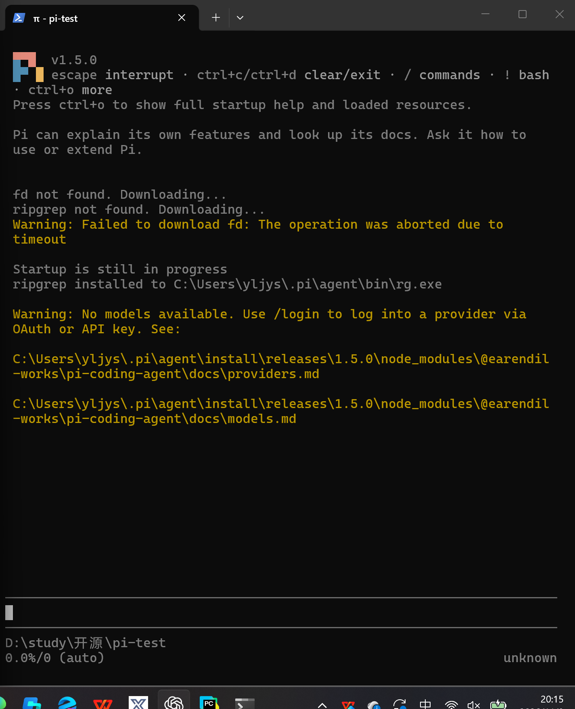
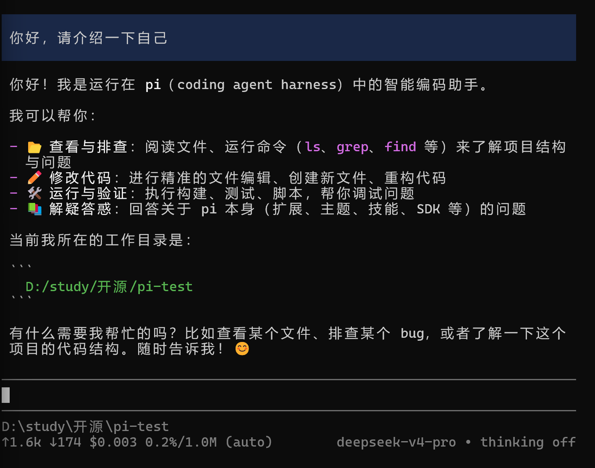
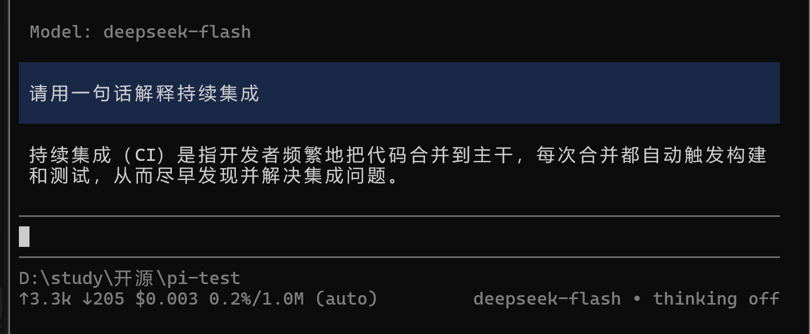
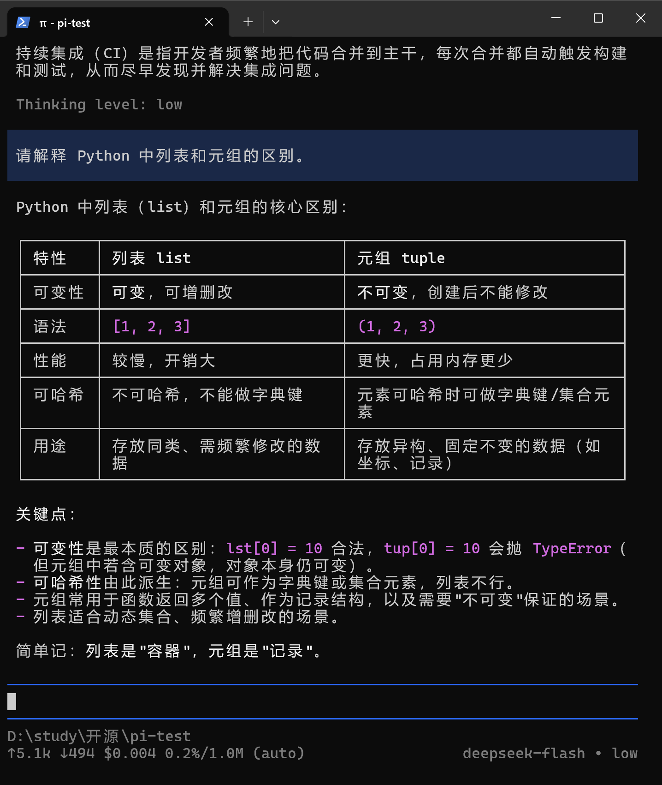
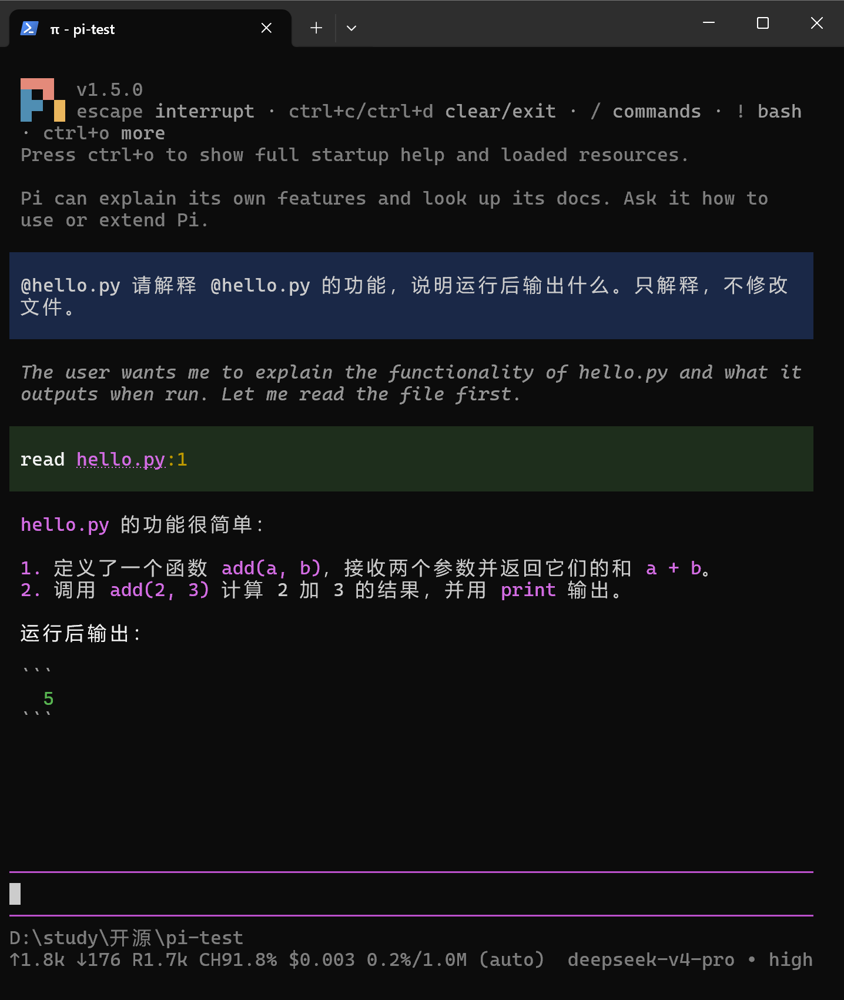
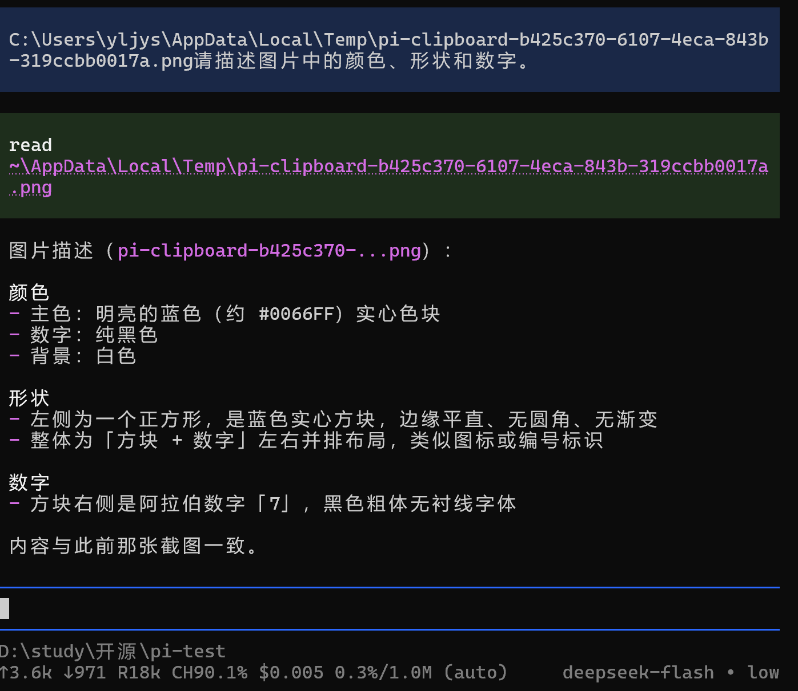
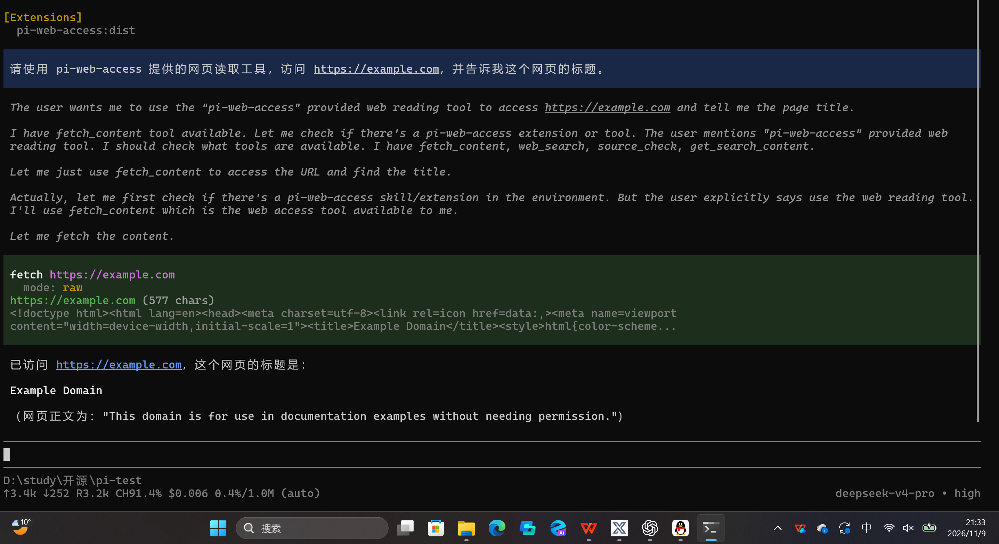
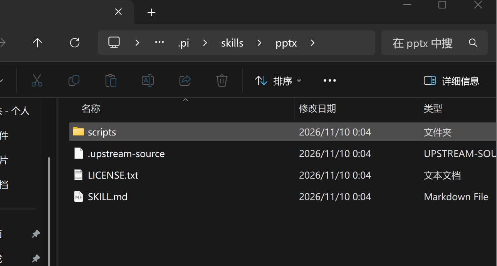
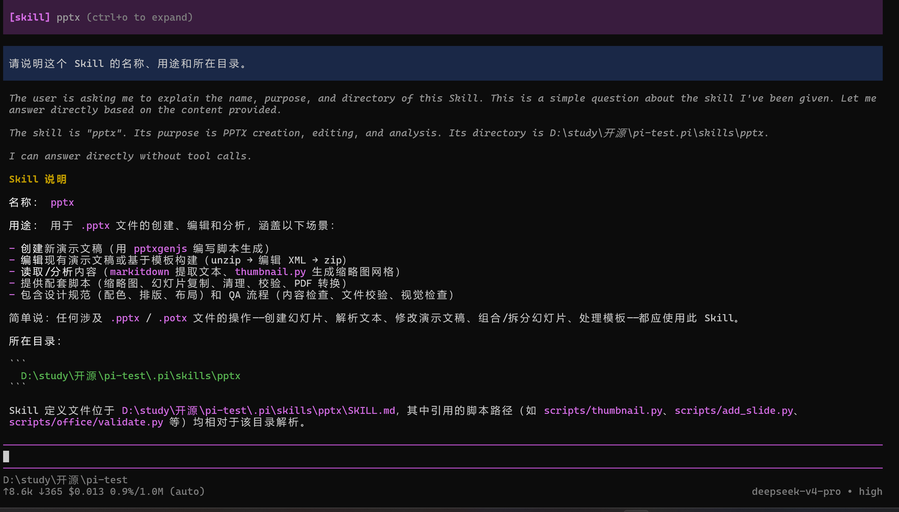

# 第一次实践课：Pi Agent 安装与基础使用

## 一、实验目的

本次实践主要学习 Pi Agent 的安装与基本使用方法，了解 AI Coding Agent 的工作机制，掌握模型配置、模型切换、文件引用、多模态图片输入、Extension 插件安装和 Skill 使用等操作。

## 二、实验环境

- 操作系统：Windows 11
- Pi Agent：v1.5.0
- Node.js：v24.18.0
- npm：v11.16.0
- 模型：deepseek-v4-pro、deepseek-flash
- 实验目录：D:\study\开源\pi-test

## 三、实验过程

### 1. Pi Agent 安装与启动

通过官方 PowerShell 安装脚本完成 Pi Agent 的安装，并配置 PATH 环境变量。使用 `pi --version` 检查安装结果，随后在实验目录中运行 `pi`，成功进入交互界面。



### 2. 配置模型并完成对话

通过 `/login` 命令配置 DeepSeek API Key，成功连接 `deepseek-v4-pro` 模型。

发送“你好，请介绍一下自己”，模型正常返回回答，说明 API 配置成功。



### 3. 模型与思考级别切换

通过 `/model` 命令将模型从 `deepseek-v4-pro` 切换为 `deepseek-flash`，并发送问题验证模型能够正常使用。



随后通过 `/thinking` 命令将思考级别从 `off` 切换为 `low`，并进行 Python 知识问答测试。



通过本实验，了解到不同模型适用于不同复杂度的任务，思考级别可以在模型支持的范围内调整推理设置。

### 4. 文件引用与图片识别

**（1）引用代码文件**

创建 `hello.py`，通过 `@` 文件引用功能让 Pi 读取并解释代码。

Pi 成功调用 `read` 工具，解释了 `add(a, b)` 函数，并正确指出程序输出为 `5`。



**（2）图片输入测试**

通过剪贴板将包含蓝色正方形和数字 7 的图片输入 Pi，使用支持视觉输入的模型进行识别。

模型成功识别图片中的颜色、形状和数字。



原始测试图片：


### 5. 安装与使用 Extension

使用以下命令安装 `pi-web-access` 插件：

```
pi install npm:pi-web-access
```

安装完成后重启 Pi，启动界面成功显示 `pi-web-access:dist`。



随后调用插件提供的 `fetch` 工具访问 `https://example.com`，成功获取网页 HTML 并提取标题 `Example Domain`。



该实验展示了 Pi 通过 Extension 扩展工具能力的方式。

### 6. 安装与调用 PPT Skill（选做）

使用 Pi Agent 从 Anthropic Skills 仓库获取 `skills/pptx` 完整目录，安装到当前项目的 `.pi/skills/pptx`。

Skill 包含 `SKILL.md`、`LICENSE.txt` 和 `scripts` 等文件。

来源仓库：https://github.com/anthropics/skills

来源 Commit：`2c5958ecac7cee2b583967a2c4981d0f4a75c579`


重新启动 Pi 后，成功在 `[Skills]` 中发现 `pptx`，并使用 `/skill:pptx` 命令加载 Skill，模型正确介绍了其用途和所在目录。



本实验验证了 Skill 的安装、自动发现及调用，未进行完整 PPT 文件生成测试。

## 四、实验问题与解决方法

1. **npm 无法运行**：PowerShell 执行策略阻止 `npm.ps1`，改用 `npm.cmd` 成功执行。
2. **文件搜索工具下载失败**：Pi 首次启动时 `fd` 下载超时，后续排查并成功完成代码文件引用。
3. **PPT Skill 下载中断**：直接访问 GitHub 失败，随后通过 codeload 重新下载，完成压缩包完整性验证和目录安装。

## 五、实验总结

通过本次实践，掌握了 Pi Agent 的基本操作，了解了 API Key、Token、模型切换、思考级别和工具调用等概念。

其中，Extension 主要用于扩展 Agent 的工具能力，而 Skill 主要用于提供特定任务的操作说明和辅助资源。

本次实践加深了对 AI Coding Agent 工作流程的理解，也积累了命令行工具安装、环境配置及网络故障排查方面的经验。
